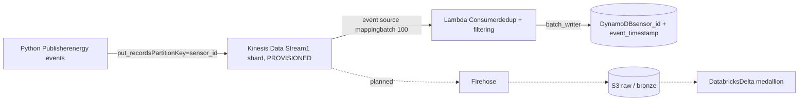

# AWS Realtime Pipelines

Real-time energy sensor ingestion platform on AWS — Kinesis, Lambda, DynamoDB, 
fully provisioned with Terraform.

> Learning-in-public project: production-grade patterns (IaC, least-privilege IAM, 
> idempotent writes, CI-ready tests) applied to a realistic energy use case.

## Architecture



## What this demonstrates

- **Streaming ingestion**: at-least-once delivery handled with intra-batch dedup 
  (Lambda) + idempotent writes (DynamoDB composite key)
- **Data quality at ingestion**: negative readings filtered, malformed payloads 
  rejected without blocking the shard (poison-pill protection)
- **Infrastructure as Code**: reusable Terraform modules, remote S3 state with 
  native locking, one-command teardown/rebuild
- **Security**: least-privilege IAM (per-resource ARNs, scoped deployer policies)

## Project structure

```
src/
  app/                      # FastAPI app (control plane)
    main.py                 # create_app(): middleware, error handlers, routers
    cli.py                  # publish events from the command line
    api/
      router.py             # registers all routers
      dependencies.py       # service wiring (Settings -> clients -> services)
      endpoints/            # health, events (sender), databricks (run jobs)
      middleware/           # request id + access log
    schemas/                # Pydantic request/response models
    services/               # business logic (EventSenderService, DatabricksRunnerService)
    clients/                # external systems (Kinesis, Databricks Jobs API)
    domain/                 # EnergyEvent (data contract) + synthetic generator
    core/                   # config (env / .env), logging, exceptions
  lambda_consumer/
    handler.py              # Kinesis -> DynamoDB Lambda (packaged alone by Terraform)
tests/                      # api/ + lambda_consumer/
deployment/
  terraform/                # envs/dev + modules (kinesis, lambda, dynamodb)
```

## Quickstart

```bash
pip install -r requirements.txt
cp .env.example .env                                     # Databricks host/token, stream...

pytest                                                   # tests (no AWS calls)
uvicorn app.main:app --app-dir src --reload              # API -> http://localhost:8000/docs

cd deployment/terraform/envs/dev && terraform init && terraform apply
```

| Endpoint | Purpose |
|---|---|
| `GET /health` | Liveness |
| `POST /events/send` | Generates `count` events (with injected duplicates + negatives) and publishes them to Kinesis (`dry_run` supported) |
| `POST /databricks/jobs/{job_id}/run` | Triggers a Databricks job (optional `job_parameters`), returns the `run_id` |
| `GET /databricks/runs/{run_id}` | Status of a Databricks run |

## Roadmap
- [x] Hot path: Kinesis → Lambda → DynamoDB
- [ ] API Gateway: query KPIs per sensor
- [ ] Cold path: Firehose → S3 → Databricks (Delta medallion)
- [ ] Dedicated infra repo with per-stack state isolation