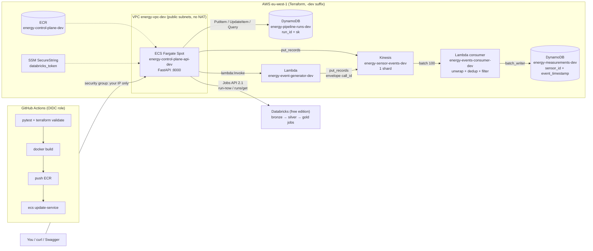
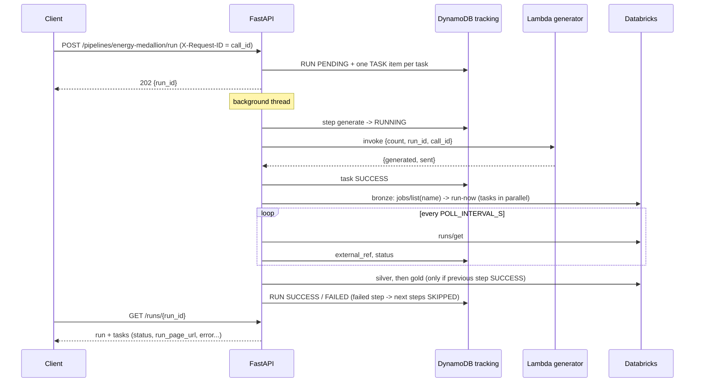

# Data Control Plane

FastAPI control plane for a big-data platform on AWS + Databricks: it launches pipelines
(Databricks jobs and AWS Lambdas, step by step, in parallel or in sequence), tracks every run
in DynamoDB, and ships with the real-time ingestion path it feeds (Kinesis → Lambda → DynamoDB).
Everything is provisioned with Terraform and deployed by GitHub Actions to ECS Fargate.

> Learning-in-public project: production-grade patterns (IaC, least-privilege IAM,
> idempotent writes, OIDC CI/CD, cost-bounded infra) applied to a realistic energy use case.

## Architecture



**A pipeline run** (`POST /pipelines/energy-medallion/run`):



## What this demonstrates

- **Orchestration**: pipelines declared in YAML (`config/pipelines.yaml`), steps in order,
  tasks in parallel or sequence, one active run per pipeline, every state change persisted
- **Traceability**: every published record carries the `call_id` of the API request or
  Lambda invocation that produced it (envelope `{call_id, type, emitted_at, data}`)
- **Streaming ingestion**: at-least-once delivery handled with intra-batch dedup
  (Lambda) + idempotent writes (DynamoDB composite key); poison-pill protection
- **Infrastructure as Code**: reusable Terraform modules, one-command teardown
- **Security**: least-privilege IAM (per-resource ARNs), OIDC for CI (no AWS keys in GitHub),
  Databricks token in SSM SecureString, API reachable from your IP only
- **Cost**: Fargate Spot 0.25 vCPU, no ALB, no NAT, on-demand DynamoDB, 7-day logs;
  `terraform destroy` removes everything including the VPC

## Project structure

```
src/
  app/                        # FastAPI control plane (Docker image)
    main.py                   # create_app(): middleware, error handlers, routers
    cli.py                    # publish events from the command line
    api/
      router.py               # registers all routers
      dependencies.py         # wiring: Settings -> clients -> repositories -> services
      endpoints/              # health, events, databricks, pipelines (+ runs)
      middleware/             # request id (= call_id) + access log
    schemas/                  # Pydantic request/response models
    services/
      pipeline_registry.py    # loads config/pipelines.yaml
      pipeline_orchestrator.py# runs steps/tasks, updates the tracking table
      task_executors.py       # DatabricksJobExecutor (run-now + poll), LambdaExecutor (invoke)
      event_sender.py, databricks_runner.py
    repositories/
      tracking_repository.py  # DynamoDB (+ in-memory) persistence of runs and tasks
    clients/                  # Kinesis, Lambda (boto3), Databricks Jobs API (httpx)
    domain/                   # Pipeline/Step/Task models, EnergyEvent, envelope, generator
    core/                     # config (env / .env), logging, exceptions
  lambda_consumer/handler.py          # Kinesis -> DynamoDB (packaged alone by Terraform)
  lambda_event_generator/handler.py   # generates events -> Kinesis (packaged alone by Terraform)
config/pipelines.yaml         # pipeline definitions (copied into the image)
tests/                        # api/, services/, lambda_consumer/, lambda_event_generator/
deployment/terraform/
  envs/dev/                   # main.tf (wiring), iam.tf (policies), variables, outputs
  modules/                    # kinesis, dynamodb, lambda, network, ecr, ecs_service, github_oidc
.github/workflows/ci-cd.yml   # tests + terraform checks, build/push/deploy on develop
Dockerfile                    # multi-stage, Poetry, non-root
```

## Quickstart (local)

```bash
poetry install
cp .env.example .env                  # TRACKING_BACKEND=memory works without AWS

poetry run pytest                     # unit tests (no AWS / Databricks calls)
poetry run uvicorn app.main:app --app-dir src --reload   # http://localhost:8000/docs
```

| Endpoint | Purpose |
|---|---|
| `GET /health` | Liveness |
| `GET /pipelines` · `GET /pipelines/{name}` | Pipelines declared in `config/pipelines.yaml` |
| `POST /pipelines/{name}/run` | Start a run (202, returns `run_id`); 409 if one is already active |
| `GET /runs/{run_id}` | Run status with every task (external_ref, run_page_url, error) |
| `GET /pipelines/{name}/runs` | Recent runs of a pipeline, newest first |
| `POST /events/send` | Generate `count` events (duplicates + negatives injected) and publish them to Kinesis |
| `POST /databricks/jobs/{job_id}/run` · `GET /databricks/runs/{run_id}` | Trigger / inspect a single Databricks job |

### Declaring a pipeline

```yaml
pipelines:
  energy-medallion:
    steps:
      - name: generate
        tasks:
          - {name: generate-events, type: lambda, function_name: energy-event-generator-dev, payload: {count: 200}}
      - name: bronze
        mode: parallel                # tasks of this step run at the same time
        tasks:
          - {name: ingest, type: databricks_job, job_name: energy_bronze_ingestion, timeout_minutes: 30}
      - name: gold
        mode: sequential              # default
        tasks:
          - {name: kpis, type: databricks_job, job_id: 123}
```

## Deploy (dev)

```bash
# 1. Infrastructure (Kinesis, Lambdas, DynamoDB x2, VPC, ECR, ECS, deploy role)
cd deployment/terraform/envs/dev
cp terraform.tfvars.example terraform.tfvars      # allowed_cidrs = your IP, databricks_host
export TF_VAR_databricks_token=dapi...             # stored in SSM SecureString
terraform init && terraform apply

# 2. First image (afterwards the CI does it on every push to develop)
aws ecr get-login-password | docker login --username AWS --password-stdin $(terraform output -raw ecr_repository_url | cut -d/ -f1)
docker build -t $(terraform output -raw ecr_repository_url):latest ../../../..
docker push $(terraform output -raw ecr_repository_url):latest
aws ecs update-service --cluster $(terraform output -raw ecs_cluster_name) --service $(terraform output -raw ecs_service_name) --force-new-deployment

# 3. GitHub: Settings -> Secrets and variables -> Actions -> Variables
#    AWS_DEPLOY_ROLE_ARN = $(terraform output -raw github_deploy_role_arn)

# 4. Find the API (no load balancer): terraform output api_public_ip_command, then http://<ip>:8000/docs

# 5. Stop paying
terraform apply -var api_desired_count=0        # pause the API only
terraform destroy                               # remove everything (VPC included)
```

### Cost (24/7, eu-west-1, approximate)

| Resource | ~ per month |
|---|---|
| Kinesis 1 provisioned shard | 14 € |
| Fargate Spot 0.25 vCPU / 0.5 GB + public IPv4 | 6 € |
| DynamoDB on-demand, Lambda, ECR, CloudWatch (7 days) | < 1 € at this volume |

Around 20 € if left running all month; the intent is `terraform destroy` after each test session.

## Roadmap
- [x] Hot path: Kinesis → Lambda → DynamoDB
- [x] Control plane: pipelines (Databricks jobs + Lambdas), tracking table, ECS deployment, CI/CD
- [ ] Endpoint authorization (API key / scopes)
- [ ] Second environment (prod) and remote Terraform state
- [ ] Kubernetes deployment variant
- [ ] Cold path: Firehose → S3 → Databricks (Delta medallion)
